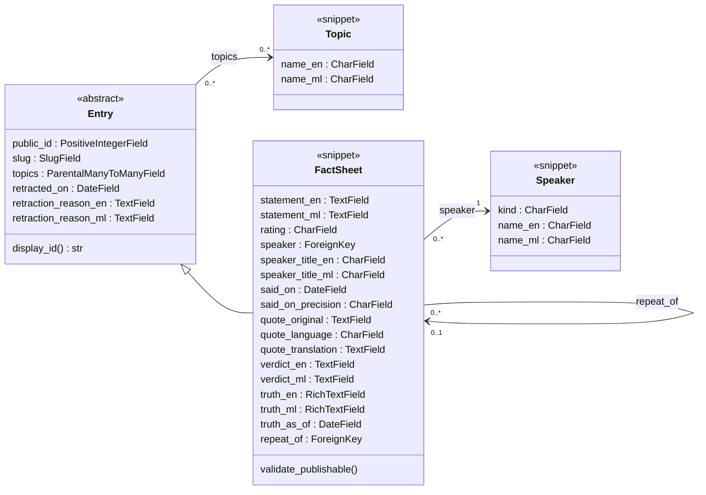
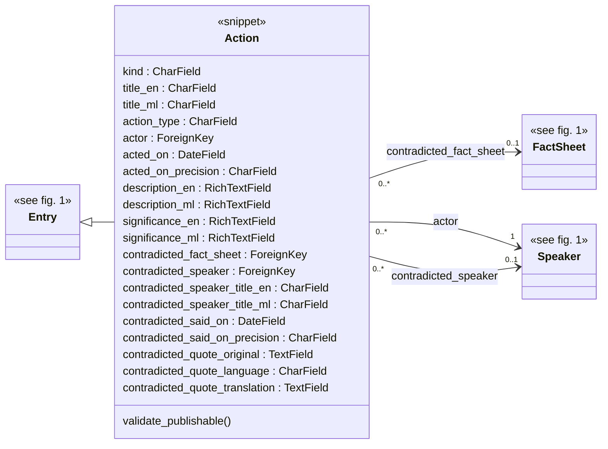
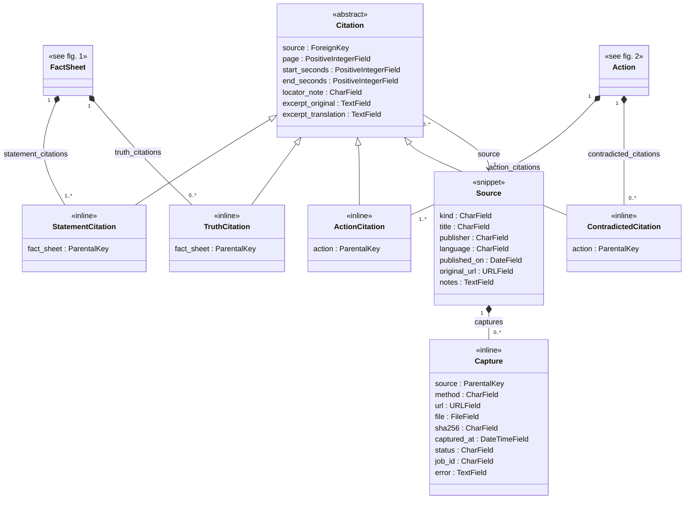
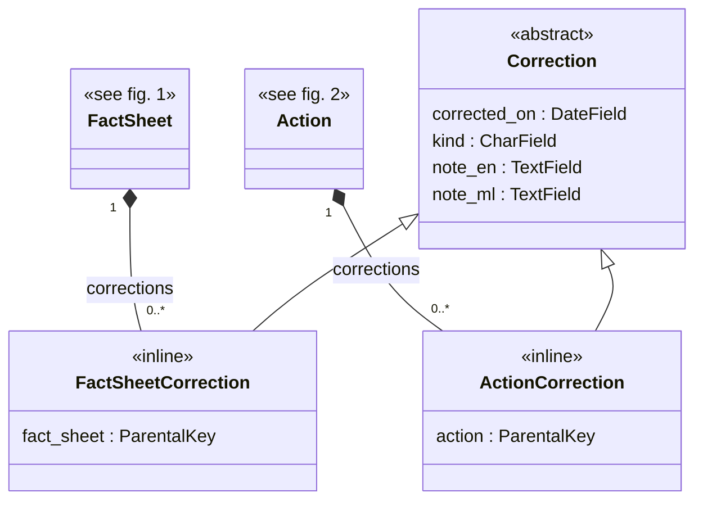

# Specification

The agreed design of the fact tracker's backend, as decided by the owner up to
15 November 2026. Anything not written here is **not decided**: ask.

Contents: [Scope](#1-scope) · [Data model](#2-data-model) · [Choices](#3-choices) ·
[Rules](#4-rules) · [Left out on purpose](#5-left-out-on-purpose) ·
[Parked and undecided](#6-parked-and-undecided) ·
[Ask before each step](#7-ask-before-each-step) ·
[Provisional choices](#8-provisional-choices) · [Useful facts](#9-useful-facts)

## 1. Scope

- The tracker records statements by the current Kerala government that are
  false, misleading or unsupported, with the evidence for the statement and
  for the truth.
- It also records government actions, but only actions that contradict a
  statement. Room is left to record any notable action later.
- The site is meant to be cited, so entries have permanent IDs, sources are
  archived, and nothing published is ever deleted.
- Everything is bilingual: English and Malayalam.
- There is one editor, the owner. There is no review workflow.
- The front end is on hold. One decision about it is fixed: each entry has a
  single page showing English and Malayalam together.

## 2. Data model

How to read the diagrams:

- `«snippet»` is a Wagtail snippet with its own admin screens. `FactSheet` and
  `Action` also use `DraftStateMixin`, `RevisionMixin`, `PreviewableMixin` and
  `ClusterableModel`: drafts, version history and preview. `Source` is a
  `ClusterableModel` so its saved copies are edited inside its form.
- `«inline»` is an `Orderable` child with a `ParentalKey`, edited inside its
  parent's form.
- `«abstract»` is an abstract Django model with no table.
- A filled diamond means the parent owns the child. A plain arrow is a
  `ForeignKey` or many-to-many. `1..*` means at least one is needed to publish.
- A box marked `«see fig. N»` is drawn in full in that figure.
- `_en` / `_ml` pairs hold the same text in both languages. Quotes and
  excerpts keep their original language in `*_original`, with a translation
  into the other language in `*_translation`.

Which app holds what:

| App | Models |
| --- | --- |
| `entries` | `Speaker`, `Topic` (built), `Entry`, `FactSheet`, `Action` |
| `evidence` | `Source`, `Capture`, `Citation` and its four subclasses |
| `api` | No models: the read-only API and the bulk downloads |

The home of `Correction` and its two subclasses is not decided.

### 2.1 Fact sheets

A fact sheet is one statement by one speaker on one date: who said it, when,
the exact quote, a one-line summary, the rating and the truth. A repeat of an
earlier statement is a new fact sheet whose `repeat_of` points to the first
sheet. `Entry` holds what fact sheets and actions share.

### 2.2 Actions

An action contradicts exactly one statement. Either `contradicted_fact_sheet`
links to the fact sheet that holds it, or the other `contradicted_*` fields
store the statement inside the action. Never both, never neither. `actor` is
who took the action.

### 2.3 Evidence

Every citation points to one `Source` and says where in it to look: a page, a
start and end time, a note, or the exact excerpt. One source can back many
entries. Its `Capture` rows are saved copies. `job_id` and `error` belong to
the automatic Wayback capture.

### 2.4 Corrections

A public, dated log on every fact sheet and action, separate from Wagtail's
internal version history.

## 3. Choices

| Field | Values |
| --- | --- |
| `FactSheet.rating` | false · misleading · unsupported |
| `*_precision` | day · month · year |
| `*_language` | ml · en · other |
| `Speaker.kind` | person · body |
| `Action.kind` | contradiction · notable (only "contradiction" can be chosen for now) |
| `Action.action_type` | government_order · cabinet_decision · legislation · budget_spending · appointment · reversal · other |
| `Source.kind` | video · news_article · newspaper_clipping · official_document · archive_link · other |
| `Capture.method` | wayback · archive_today · stored_file |
| `Capture.status` | pending · ok · failed |
| `Correction.kind` | correction · clarification · update |

## 4. Rules

1. **Public IDs.** `public_id` is assigned the first time an entry is
   published, with one sequence for fact sheets and another for actions. The
   prefix letters (`C` and `A` unless changed) are set once in the site
   settings before launch. Drafts have no number.
2. **Retract, never delete.** A published entry is never deleted. Retracting
   sets `retracted_on` and a reason, and the entry stays public with a notice.
   Only drafts that were never published can be deleted. A source or speaker
   that an entry uses cannot be deleted.
3. **Publishing a fact sheet** needs the statement summary in at least one
   language, a rating, a speaker, a date, the exact quote and at least one
   statement citation. It also needs at least one truth citation, unless the
   rating is Unsupported. The quote's translation, the verdict, the
   explanation, the "facts checked on" date (`truth_as_of`), the speaker's
   title and topics are optional. Drafts can be saved without any of this.
4. **Publishing an action** needs a title and description in at least one
   language, a date, a type, who acted, why it matters (`significance`), at
   least one citation for the action, and the contradicted statement: either a
   linked fact sheet, or a stored statement with its speaker, date, exact
   quote and at least one citation.
5. **Repeats.** `repeat_of` must point to a sheet that is not itself a repeat.
6. **Languages.** Either language can be written first. There is no separate
   Malayalam address and no "language ready" rule.
7. **Speakers and topics.** Each needs a name in at least one language. The
   software has no rule about who can be added. A speaker has a name only; the
   title at the time is stored on each fact sheet.
8. **Archiving.** Saving a source with an original URL queues a Wayback
   capture on the Django-Q2 worker. The result is a `Capture` with a status,
   the Internet Archive's job ID and, on failure, the error. archive.today
   links and stored files are added by hand. Stored files are the full files,
   are public, and carry a SHA-256 hash.
9. **Storage.** Stored files are kept on the server's disk for now.
10. **Public data.** A read-only JSON API plus bulk CSV and JSON downloads.
    Both carry published entries only, show retracted ones with their
    retraction, and always include both languages. A source's `notes` are
    internal and never public.
11. **Version history** is kept for fact sheets and actions only.
12. **Admin menu.** Every model has its own item in the Wagtail main menu.

## 5. Left out on purpose

Do not add these without asking:

- Government replies to a fact sheet. The owner will not contact the government.
- A log of statements that were checked and found accurate.
- A review workflow before publishing.
- A shared outlets list. A source's `publisher` is plain text.
- The venue of a statement.
- Version history on sources, speakers and topics.
- Caddy, or any proxy, in the development setup.

## 6. Parked and undecided

- **Page addresses** wait for the front end. The owner chose an English slug
  earlier, so `Entry.slug` stays. The address pattern is not decided.
- **The bilingual page's layout** waits for the front end.
- **Hosting** is not decided. The recommendation given was one small VPS
  running Docker Compose.
- **Cloudflare R2** is being considered for backup, storage or both.
- **The site's name.**

## 7. Ask before each step

These came up during design and were not settled. The list is a start, not a
limit: ask about anything else that is unclear.

**4. Sources and saved copies**
- Which file types and what maximum size are allowed for stored files?
- May two sources share the same `original_url`?
- What does the source type `archive_link` mean beside saved copies?
- Which fields does each `Capture.method` require (link, file, or both)?
- Which app holds the corrections models?

**5. Fact sheets**
- Is `slug` typed by hand or generated, and from what?
- Which formatting is allowed in the `truth_*` rich text?
- Wagtail autosaves snippets that keep revisions. Keep that for fact sheets?
- What should the snippet preview show while there is no front end?
- May a repeat be saved before the sheet it repeats is published?

**6. Actions**
- How does the form switch between a linked fact sheet and a stored statement?

**7. The Wayback job**
- Where do the Internet Archive API keys come from, and who creates the account?
- How often, and how many times, is a failed capture retried?
- Should Django's own admin be added to show Django-Q2's task screens?

**8. API and downloads**
- The URL prefix and version, the page size, and which filters are offered.
- The shape of the CSV files, given that an entry has many citations.
- Are the download files built on request or regenerated on publish?

**9. Sample data**
- Sample entries must be plainly fictional. Never attribute an invented
  statement to a real person or body. Confirm the approach with the owner.

**10. Production**
- Hosting, HTTPS, backups, and where stored files live.
- Split the instructions: one file for development, one for production.

## 8. Provisional choices

Made while building patches 1 and 2 without an explicit decision. The owner
has seen them and may change any of them:

- The project is named `fact-tracker` in `pyproject.toml`, as a placeholder.
- The development database and user are both called `tracker`.
- The time zone is `Asia/Kolkata`.
- Django's own admin and Wagtail's forms and redirects modules are not installed.
- In development, uploads go to a Docker volume and the site is on port 8000.
- uv is installed in the image with pip, pinned to one version.
- `BilingualName` is an abstract base for the two name fields. The database
  also enforces "at least one name".
- Duplicate speaker or topic names are allowed. Names hold up to 200 characters.
- When both names exist the English one is the label, and lists sort by it.

## 9. Useful facts

Checked on 15 November 2026. Check again before relying on them.

- The `postgres:18` image expects its volume at `/var/lib/postgresql`, not at
  `/var/lib/postgresql/data` as older images did.
- PostgreSQL 19 was about to be released. The owner chose 18.
- Wagtail 7.4 supports Django 5.2 and 6.0. Django-Q2 1.11 needs Django 5.2 or newer.
- Wagtail defers required-field checks when a draft is saved, which fits
  "drafts can be saved without sources".
- The Internet Archive's Save Page Now API needs an account's API keys. A
  capture is requested first and its status is checked later by job ID.
- Cloudflare's proxy rejects uploads over 100 MB on its Free and Pro plans,
  which matters for full video files uploaded through the admin.
- Cloudflare R2 does not charge for downloads.
- The owner runs Claude Code in the browser. A cloud session clones the
  repository from GitHub, so the owner pushes before each new chat. Within
  one chat the patches are progressive: each builds on the previous one.
  A cloud session has Docker and Docker Compose. Its default is to push a
  branch when it stops; rule 2 in `CLAUDE.md` overrides that.
- Patches 1 and 2 were written where Docker could not run and only
  PostgreSQL 16 was available. The owner reported that patch 1 passed.
